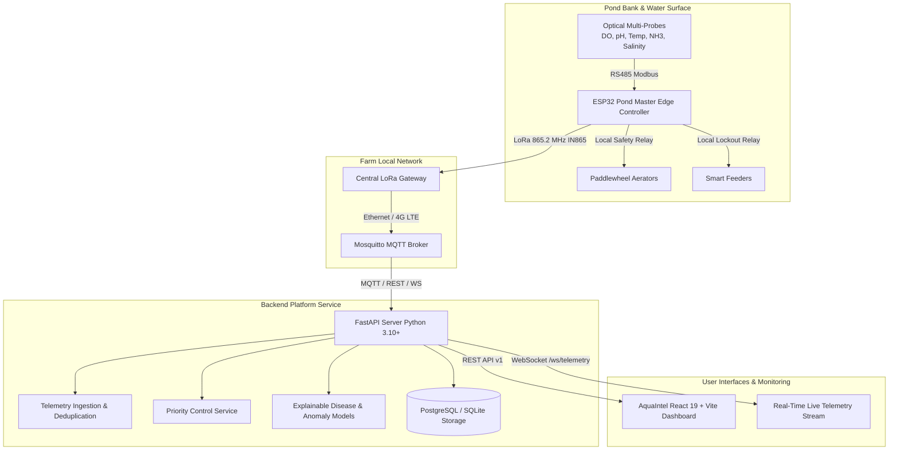

# AquaIntel — System Architecture Specification
### Smart Prawn Farm Automation & AI-Based Disease Risk Management
*Target Deployment: 10-Hectare Commercial Penaeus vannamei Farm in Nellore, Andhra Pradesh, India*

---

## 1. System Overview & Core Workflow

AquaIntel is an enterprise-grade digital aquaculture automation and artificial intelligence platform. Its fundamental operational loop follows the principle:

```
SENSE ──► VALIDATE ──► ANALYZE ──► PREDICT ──► DECIDE ──► ACT ──► VERIFY
```

1. **SENSE:** Submerged optical sensor buoys sample water quality parameters (DO, pH, temperature, salinity, ammonia, turbidity, water level) at 3-second intervals.
2. **VALIDATE:** The edge controller performs immediate range validation and sanity checks (detecting disconnected probes, out-of-bound jumps, or frozen ADC readings).
3. **ANALYZE:** Time-series feature extraction evaluates diurnal curves, DO drop velocity (mg/L/hr), and cumulative stress indicators.
4. **PREDICT:** AI and rule-based models forecast environmental disease risk (WSSV, Vibriosis, EMS/AHPND) and check-tray feeding response.
5. **DECIDE:** Multi-stage priority decision engine evaluates hardware emergency rules, local water quality thresholds, anti-cycle hysteresis, and operator daily quotas.
6. **ACT:** Actuator commands are dispatched to aerator VFDs/contactors and automated solar feeders with cryptographic message IDs, expiration timestamps, and delivery guarantees.
7. **VERIFY:** Current sensor feedback confirms physical dissolved oxygen restoration, check-tray clearance, and motor electrical current draw.

---

## 2. High-Level Architecture Diagram



---

## 3. Modular Decoupling & Failure Isolation

AquaIntel strictly segregates responsibilities across independent services:
- **Local Autonomy:** Loss of internet or cloud connectivity does **not** interrupt critical pond aeration. The local edge state machine continues dissolved oxygen monitoring and hysteresis aerator control.
- **Dry-Run & Simulation:** The platform includes an internal deterministic telemetry generator capable of simulating all 15 operational and failure scenarios without physical hardware.
- **Auditability:** Every command, parameter change, threshold adjustment, and alert acknowledgment is immutably logged to the `audit_logs` table.
