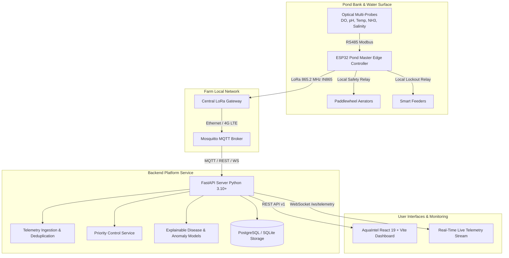

# AquaIntel — System Architecture Specification
### Smart Prawn Farm Automation & AI-Based Disease Risk Management
*Target Deployment: 10-Hectare Commercial Penaeus vannamei Farm in Nellore, Andhra Pradesh, India*

---

## 1. System Overview & Core Workflow

AquaIntel is an enterprise-grade digital aquaculture automation and artificial intelligence platform. Its fundamental operational loop follows the principle:

```
SENSE ──► VALIDATE ──► ANALYZE ──► PREDICT ──► DECIDE ──► ACT ──► VERIFY
```

1. **SENSE:** Submerged optical sensor buoys sample water quality parameters (DO, pH, temperature, salinity, ammonia, turbidity, water level) at 3-second intervals.
2. **VALIDATE:** The edge controller performs immediate range validation and sanity checks (detecting disconnected probes, out-of-bound jumps, or frozen ADC readings).
3. **ANALYZE:** Time-series feature extraction evaluates diurnal curves, DO drop velocity (mg/L/hr), and cumulative stress indicators.
4. **PREDICT:** AI and rule-based models forecast environmental disease risk (WSSV, Vibriosis, EMS/AHPND) and check-tray feeding response.
5. **DECIDE:** Multi-stage priority decision engine evaluates hardware emergency rules, local water quality thresholds, anti-cycle hysteresis, and operator daily quotas.
6. **ACT:** Actuator commands are dispatched to aerator VFDs/contactors and automated solar feeders with cryptographic message IDs, expiration timestamps, and delivery guarantees.
7. **VERIFY:** Current sensor feedback confirms physical dissolved oxygen restoration, check-tray clearance, and motor electrical current draw.

---

## 2. High-Level Architecture Diagram



---

## 3. Modular Decoupling & Failure Isolation

AquaIntel strictly segregates responsibilities across independent services:
- **Local Autonomy:** Loss of internet or cloud connectivity does **not** interrupt critical pond aeration. The local edge state machine continues dissolved oxygen monitoring and hysteresis aerator control.
- **Dry-Run & Simulation:** The platform includes an internal deterministic telemetry generator capable of simulating all 15 operational and failure scenarios without physical hardware.
- **Auditability:** Every command, parameter change, threshold adjustment, and alert acknowledgment is immutably logged to the `audit_logs` table.

---

## 4. Dynamic Climate Adaptation Engine & Multi-Horizon Predictive Forecasting

To prevent rigid seasonal assumptions (e.g., assuming summer is always dry or winter is always cold), AquaIntel integrates a real-time weather provider with pond sensor telemetry:

1. **Weather Service (`WeatherService`):** Connects to Open-Meteo REST API using the farm's exact coordinates (14.4426°N, 79.9865°E in Nellore, AP). Incorporates a 15-minute in-memory cache, data freshness tracking, and automatic coastal diurnal empirical simulation fallback.
2. **Measurement vs. Calculated Metric Segregation:**
   - *Direct Sensors:* Water temperature (°C), DO (mg/L), pH, Salinity (ppt), TAN (mg/L), Turbidity (NTU), Water level (cm).
   - *Calculated Estimates:* Unionized Ammonia ($NH_3$) derived via Emerson & Trussell equilibria equations; Dissolved Oxygen saturation percentage derived via Benson & Krause equations.
3. **Multi-Horizon Predictive Forecaster (`PondPredictiveEngine`):**
   - Forecasting horizons: **3h, 6h, 12h, 24h, 72h, and 168h (7 days)**.
   - Outputs calibrated 90% confidence uncertainty envelopes ($\pm 1.645 \sigma$).
   - Benchmarked against **Persistence** and **Seasonal-Naive** baseline models via walk-forward validation (reporting MAE and RMSE).
4. **Dynamic Stressor & Anomaly Detection:**
   - Detects `SUMMER_RAIN` (thermal stratification risk and osmotic shock), `RAINY_SUNSHINE` (algal crash and rapid photo-oxidation), `HEAVY_RAIN` (freshwater dilution and dyke overflow risk), `HOT_AFTERNOON` (super-saturation followed by nocturnal oxygen collapse), `COLD_SNAP` (reduced shrimp gut transit and metabolic slow-down), and `SENSOR_WEATHER_CONFLICT`.
5. **Fail-Safe Decoupling & Operator Governance:**
   - Emergency hypoxic safety interlocks ($DO < 3.2\text{ mg/L}$) take absolute precedence over weather forecasts, immediately enforcing maximum aeration and 100% feed lockout.
   - Physical feed and aeration adaptations strictly require explicit operator approval before actuation dispatch.

