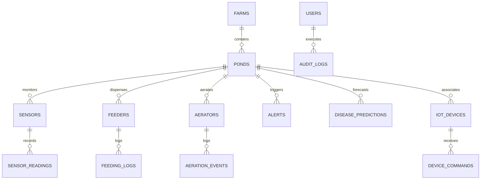

# AquaIntel — Database Schema & Data Architecture

AquaIntel utilizes SQLAlchemy 2.0 with Alembic version-controlled migrations. The schema is designed for zero-config development on SQLite (`sqlite:///./aquaintel.db`) and horizontal scalability on PostgreSQL (`postgresql://...`).

---

## 1. Entity Relationship Overview



---

## 2. Table Specifications

### Core Models:
- **`farms`**: Master farm record (area in hectares, location, water source, backup power, currency).
- **`ponds`**: Individual 1-hectare culture ponds (pond number, PL stocking count, current biomass, target FCR, species, archived state).
- **`sensors`**: Submersible multi-probe channel configurations (DO, pH, temp, salinity, ammonia, turbidity, water level).
- **`sensor_readings`**: High-frequency telemetry snapshots with indexed timestamp and status indicators.
- **`feeders`**: Automated solar feeder RTUs (hopper capacity, feed rate, daily quota).
- **`feeding_logs`**: Historical dispensed batches, planned vs actual amounts, and environmental reduction reasons.
- **`aerators`**: Paddlewheel and jet aerators (power rating in kW, runtimes, anti-cycle timer constraints).
- **`aeration_events`**: State transition history (trigger DO, duration, reason).
- **`disease_predictions`**: Additive multi-stressor risk scores for WSSV, Vibriosis, and EMS/AHPND.
- **`alerts`**: Deduplicated farm alarms with severity tiers (`INFO`, `WARNING`, `HIGH`, `CRITICAL`) and lifecycle states (`ACTIVE`, `ACKNOWLEDGED`, `RESOLVED`, `IGNORED`).
- **`iot_devices`**: Hardware device inventory (ESP32 pond master nodes, LoRa gateways, battery %, RSSI dBm).
- **`device_commands`**: Command lifecycle tracking with `issued_at`, `expires_at`, `acknowledged_at`, and delivery states (`PENDING`, `ACKNOWLEDGED`, `COMPLETED`, `FAILED`, `EXPIRED`).
- **`audit_logs`**: Immutable record of security actions, threshold updates, and manual overrides.
- **`ingested_telemetry`**: Message deduplication and raw payload provenance archive.

---

## 3. Database Migrations (Alembic)

Alembic configuration is maintained in `backend/alembic.ini` and `backend/alembic/`.

### Commands:
```bash
# Check current migration revision
alembic current

# Generate new migration following model changes
alembic revision --autogenerate -m "describe_changes"

# Upgrade database to latest revision
alembic upgrade head

# Rollback one migration revision
alembic downgrade -1
```
